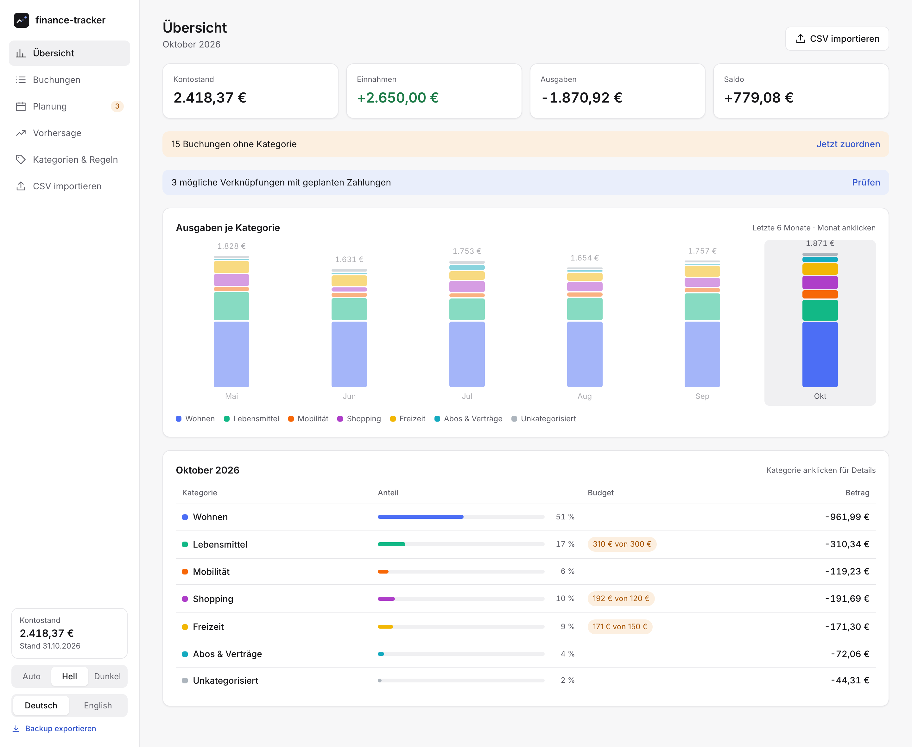
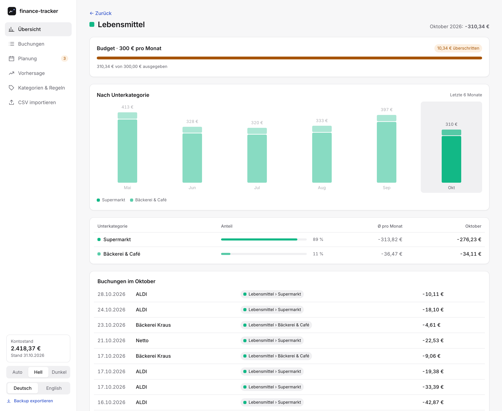
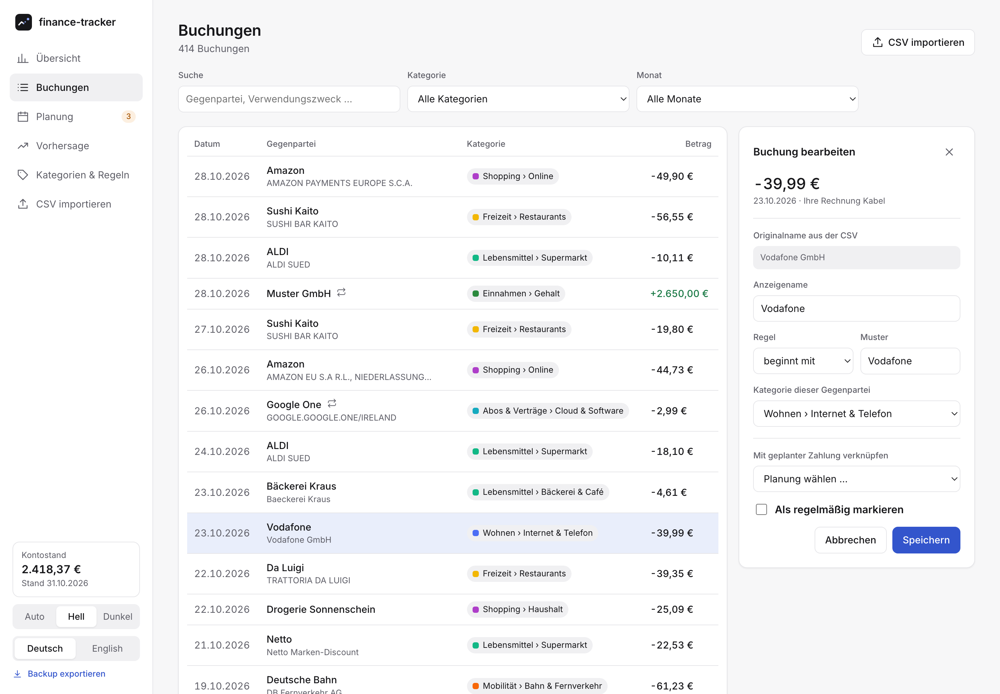
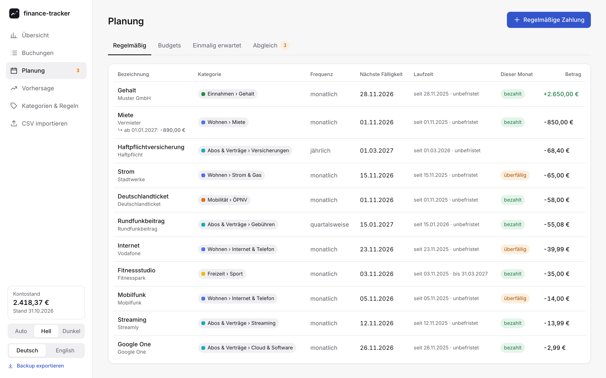
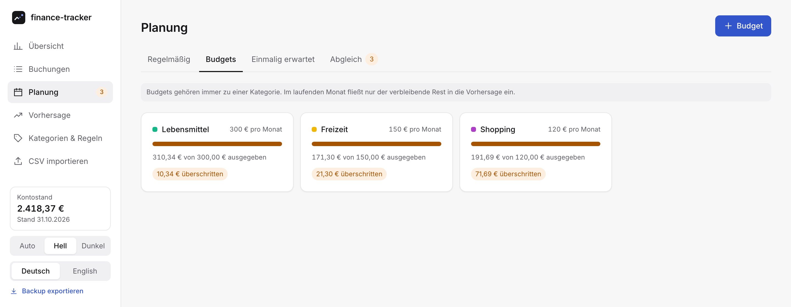
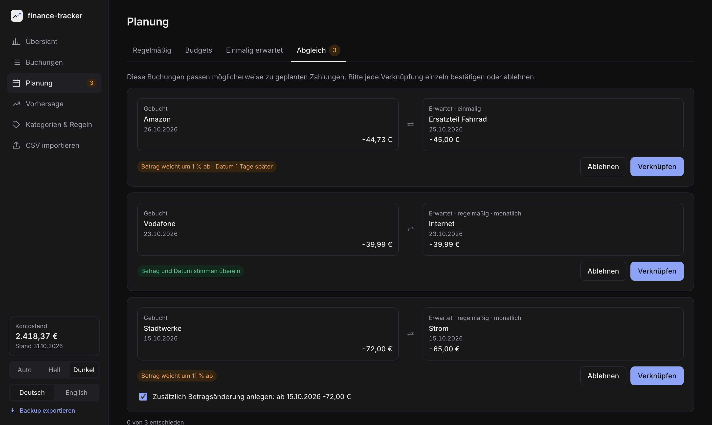
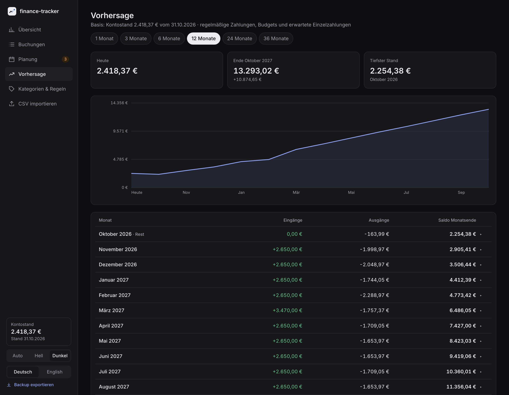
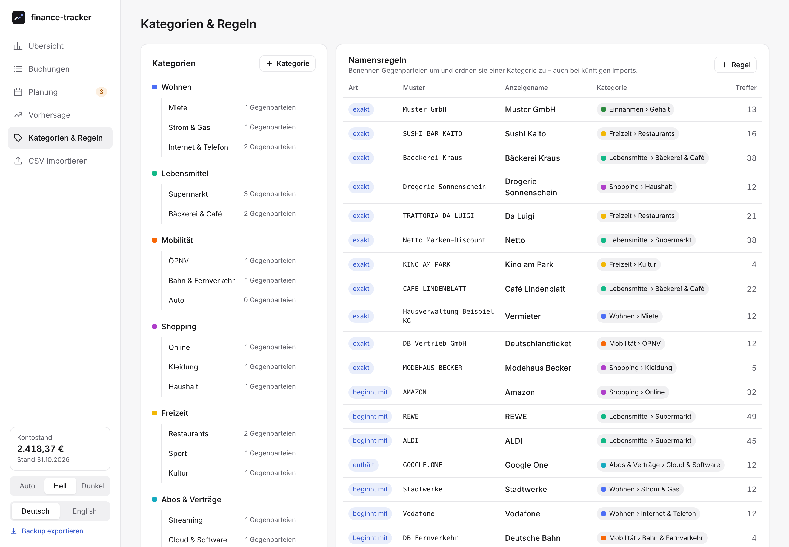
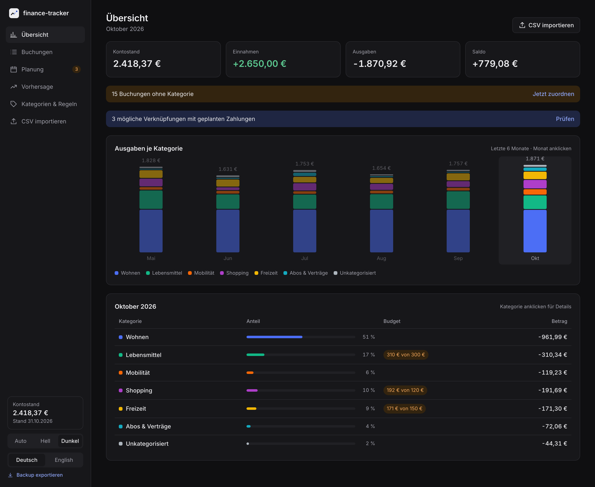
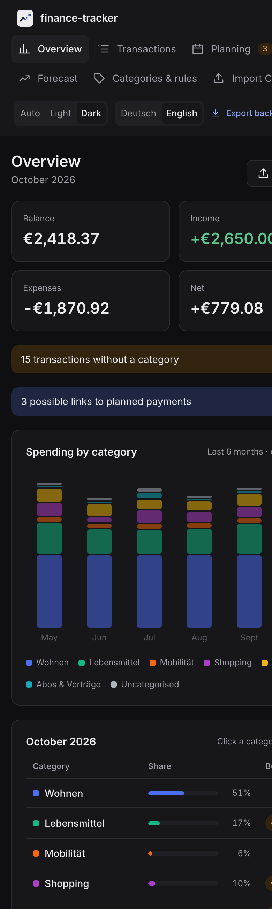

<p align="center">
  <picture>
    <source media="(prefers-color-scheme: dark)" srcset="docs/logo-dark.svg">
    
  </picture>
</p>

<h1 align="center">finance-tracker</h1>

<p align="center">
  Minimalistischer, lokaler Finanz-Tracker: Kontoauszüge als CSV importieren,<br>
  Ausgaben verstehen, Zahlungen planen und den Kontostand der nächsten Monate vorhersagen.
</p>

<p align="center">
  
</p>

---

## Warum?

Die meisten Finanz-Apps wollen Bankzugang, ein Konto in der Cloud und zeigen dir zehn Dinge, die du nicht brauchst.
**finance-tracker** macht nur das Nötige – und alles bleibt auf deinem Rechner:

- 🔒 **Lokal & privat** – eine SQLite-Datei in `data/`, Server nur auf `127.0.0.1`, keine externen Requests (auch die Schrift ist eingebettet).
- 📥 **CSV statt Bank-API** – Export aus dem Online-Banking hochladen, fertig. Dubletten werden erkannt.
- 🔮 **Vorhersage** – regelmäßige Zahlungen, Budgets und erwartete Einzelzahlungen ergeben den Kontostand für 1 bis 36 Monate.
- 🌗 **Hell & dunkel, Deutsch & Englisch.**

## Funktionen

### Übersicht & Kategorien
Monatliche Ausgaben je Kategorie als gestapelte Balken, darunter die Aufteilung des gewählten Monats mit Budget-Stand.
Ein Klick auf eine Kategorie zeigt die Unterkategorien im Verlauf und die zugehörigen Buchungen.

<p align="center">
  
</p>

### Buchungen, Gegenparteien & Namensregeln
Aus kryptischen Namen wie `AMAZON EU S.A R.L., NIEDERLASSUNG DEUTSCHLAND` wird per Regel *„beginnt mit AMAZON → Amazon“*.
Regeln (*exakt*, *beginnt mit*, *enthält*) gelten rückwirkend und für alle künftigen Imports.
Jede Gegenpartei hat eine Kategorie – ihre Buchungen folgen automatisch.

<p align="center">
  
</p>

Eine Buchung lässt sich direkt **als regelmäßig markieren** (Frequenz, Betrag, Laufzeit).
Frühere Buchungen derselben Gegenpartei werden dabei zur Zuordnung vorgeschlagen; ähnliche Beträge (±10 %) sind vorausgewählt.

### Planung
Drei Arten von Planposten:

| | Beispiel | Besonderheit |
|---|---|---|
| **Regelmäßig** | Miete, Gehalt, Rundfunkbeitrag | monatlich, quartalsweise, halbjährlich oder jährlich; **Betragsänderungen ab Datum** |
| **Budget** | Lebensmittel 300 €/Monat | immer an eine Kategorie gebunden; im laufenden Monat zählt nur der **Rest** |
| **Einmalig erwartet** | Steuererstattung am 15.03. | wird erledigt, sobald die passende Buchung verknüpft ist |

<p align="center">
  
</p>

<p align="center">
  
</p>

### Abgleich – nichts passiert ohne dich
Nach jedem Import sucht der Tracker Buchungen, die zu geplanten Zahlungen passen (gleiche Gegenpartei, ähnlicher Betrag, Datum in der Nähe).
**Jede Verknüpfung bestätigst oder lehnst du einzeln ab.** Weicht der Betrag ab, kann direkt eine Betragsänderung angelegt werden.
Nicht verknüpfte Zahlungen werden nach ein paar Tagen als *überfällig* markiert und bleiben in der Vorhersage.

<p align="center">
  
</p>

### Vorhersage
Ausgehend vom Kontostand aus dem letzten Import: Rest des laufenden Monats plus 1, 3, 6, 12, 24 oder 36 Monate.
Jeder Monat lässt sich bis auf die einzelnen Posten aufklappen.

<p align="center">
  
</p>

### Kategorien & Regeln
Zwei Ebenen (Kategorie → Unterkategorie), frei anlegbar, mit Farbe. Daneben alle Namensregeln und eine Liste der noch nicht kategorisierten Gegenparteien zum schnellen Zuordnen.

<p align="center">
  
</p>

<table>
  <tr>
    <td width="68%"></td>
    <td></td>
  </tr>
  <tr>
    <td align="center"><sub>Dark Mode</sub></td>
    <td align="center"><sub>Schmale Fenster & Englisch</sub></td>
  </tr>
</table>

## Schnellstart

Voraussetzung: **Node.js ≥ 22.13** (nutzt das eingebaute `node:sqlite`, keine nativen Abhängigkeiten).

```bash
npm install
npm start          # baut das Frontend und startet http://localhost:4321
```

Dann unter **CSV importieren** den Export deiner Bank hochladen.
Die Daten liegen in `data/finance.db` – für ein Backup diese Datei kopieren oder in der App *Backup exportieren* (JSON) nutzen.

### Ausprobieren mit Demo-Daten

```bash
npm run demo       # erzeugt data/demo.db mit 12 Monaten erfundener Buchungen und startet die App
```

### Entwicklung

```bash
npm run dev        # API (tsx watch) + Vite mit Hot Reload auf http://localhost:5173
npm test           # Vitest: Importer, Datenbank, Abgleich, Vorhersage
npm run typecheck
```

| Variable | Standard | Bedeutung |
|---|---|---|
| `FT_DB` | `data/finance.db` | Pfad zur SQLite-Datei |
| `PORT` | `4321` | Port des Servers |

Theme und Sprache lassen sich auch per URL setzen, z. B. `?theme=dark&lang=en`.

## CSV-Formate

| Bank | Format | Erkannt an |
|---|---|---|
| DKB | Girokonto-Export (seit 2023, `;`-getrennt) | Spalten `Buchungsdatum`, `Zahlungsempfänger*in`, `Betrag (€)` |

Vorgemerkte Buchungen werden übersprungen, der Kontostand aus dem Dateikopf wird als Startwert der Vorhersage übernommen.
Dateien in UTF-8 und Windows-1252 werden beide gelesen.

### Eine weitere Bank hinzufügen

Ein Importer ist ein kleines Modul mit zwei Funktionen – der Rest der App bleibt unverändert:

```ts
// src/server/importers/meine-bank.ts
import { parseCsv, parseGermanAmount, parseGermanDate } from './csv';
import type { Importer } from './types';

export const meineBank: Importer = {
  id: 'meine-bank-giro',
  name: 'Meine Bank Girokonto',
  detect: (text) => text.includes('Buchungstag') && text.includes('Umsatz in EUR'),
  parse: (text) => {
    const [header, ...lines] = parseCsv(text);
    // … jede Zeile in { date, valueDate, amount (Cent), counterparty, purpose, iban, type, pending } umwandeln
    return { balance: null, rows: [], errors: [] };
  }
};
```

Dann in [`src/server/importers/index.ts`](src/server/importers/index.ts) registrieren und mit einer anonymisierten Beispieldatei in `tests/fixtures/` testen.
Wichtig: `counterparty` ist immer die *andere* Seite – bei Ausgaben der Empfänger, bei Eingängen der Absender.

## Aufbau

```
src/
├── shared/      Fachlogik ohne I/O – Regeln, Planposten, Abgleich, Vorhersage, Statistik
├── server/      Hono-API, SQLite-Store, Migrationen, Importer, Demo-Daten
└── client/      React-Frontend (Vite), Seiten, Diagramme, i18n
tests/           Vitest + anonymisierte CSV-Fixture
```

- Beträge sind durchgehend **Integer-Cent**, Datumsangaben ISO-Strings ohne Zeitzone.
- Der Server liefert den gesamten Zustand (`GET /api/state`); Auswertungen, Abgleich-Vorschläge und Vorhersage rechnet `src/shared` im Browser – für ein privates Girokonto mit einigen tausend Buchungen mehr als schnell genug.
- Das Schema wird über `PRAGMA user_version` migriert.

## Lizenz

Privates Projekt.
