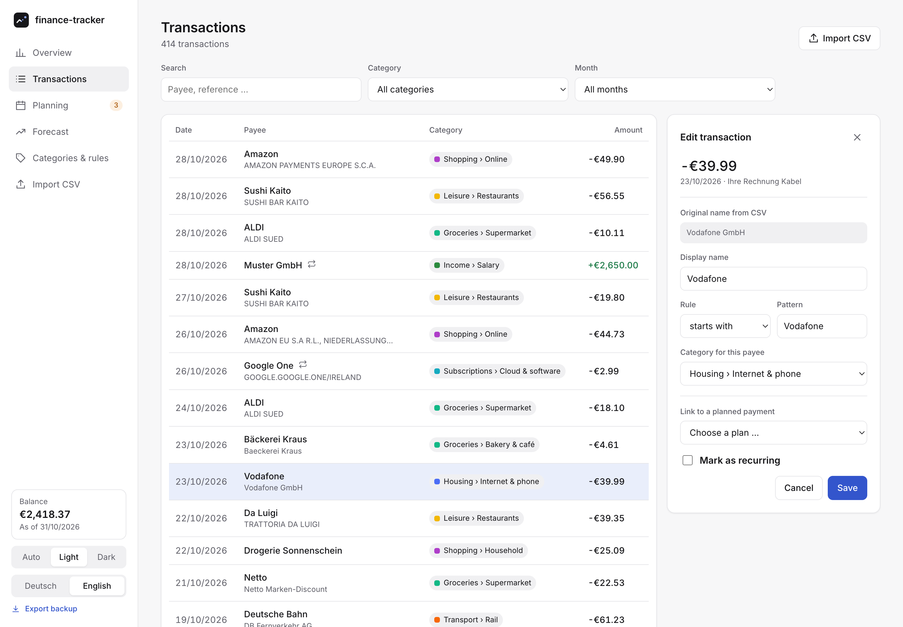
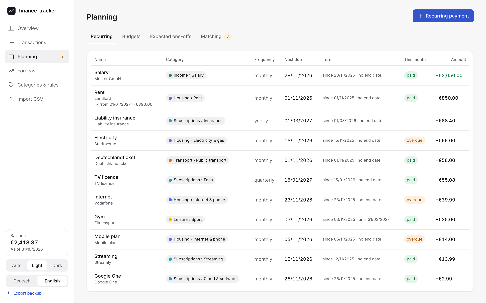
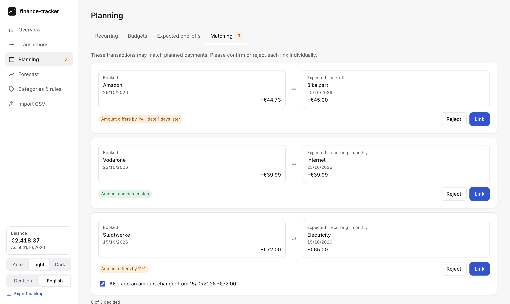
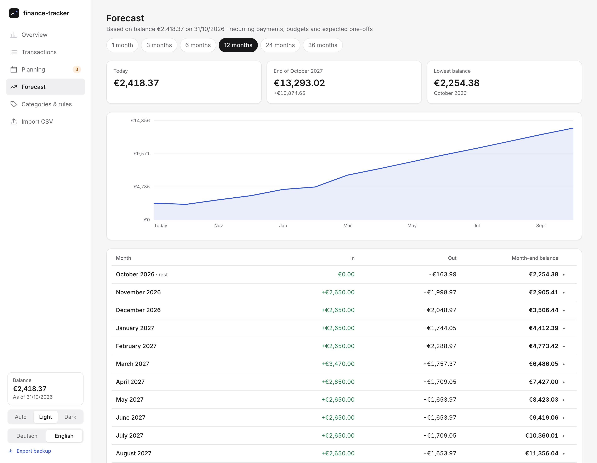

<p align="center">
  <picture>
    <source media="(prefers-color-scheme: dark)" srcset="docs/logo-dark.svg">
    
  </picture>
</p>

<h1 align="center">finance-tracker</h1>

<p align="center">
  A minimal, local-first finance tracker: import bank CSV exports, see where your money goes,<br>
  plan recurring payments and forecast your balance for the months ahead.
</p>

<p align="center">
  <picture>
    <source media="(prefers-color-scheme: dark)" srcset="docs/screenshots/overview-dark.png">
    
  </picture>
</p>

## Features

- **Private by design** – one SQLite file, server bound to `127.0.0.1`, no external requests.
- **CSV import** – bank detected automatically, duplicates skipped, pending bookings ignored. Ships with DKB; other banks plug in as importer modules.
- **Payee rules** – turn `AMAZON EU S.A R.L., NIEDERLASSUNG…` into *Amazon* (exact / starts with / contains), for past and future imports.
- **Categories** – two levels; assign a payee once and all its transactions follow. After an import, uncategorised payees are listed by frequency and assigned by keyboard (type, Enter, next).
- **Planning** – recurring payments with amount changes, monthly budgets per category and expected one-off payments.
- **Recurring detection** – monthly, quarterly, half-yearly and yearly payments are found in your history, including amount changes and ended contracts; create them all with one click, past bookings linked.
- **Matching** – bookings are suggested for planned payments; confirm one by one, per plan, or all clear matches at once.
- **Bulk actions** – select transactions (Shift-click for ranges) to set a category, merge payees, link them to a plan or create a recurring payment from them.
- **Forecast** – balance for 1 to 36 months, broken down month by month.
- Light & dark theme, English & German.

<p align="center">
  <picture>
    <source media="(prefers-color-scheme: dark)" srcset="docs/screenshots/transactions-dark.png">
    
  </picture>
</p>

<p align="center">
  <picture>
    <source media="(prefers-color-scheme: dark)" srcset="docs/screenshots/planning-dark.png">
    
  </picture>
</p>

<p align="center">
  <picture>
    <source media="(prefers-color-scheme: dark)" srcset="docs/screenshots/matching-dark.png">
    
  </picture>
</p>

<p align="center">
  <picture>
    <source media="(prefers-color-scheme: dark)" srcset="docs/screenshots/forecast-dark.png">
    
  </picture>
</p>

## Getting started

Requires **Node.js ≥ 22.13** (uses the built-in `node:sqlite`).

```bash
npm install
npm start        # builds and serves http://localhost:4321
npm run demo     # same, with twelve months of invented demo data
```

Your data lives in `data/finance.db` (`FT_DB` to change it, `PORT` for the port). Back it up by copying the file, or sync it with Google Drive.

### Google Drive sync

Optional, and only when you click *Sync*: local changes are uploaded to a `finance-tracker` folder in your Google Drive,
changes made on another computer are downloaded. The sidebar shows *Unsynced changes* when the local data differs from
the last sync, and *Newer version in Drive* when another computer synced in the meantime (checked on start, when the
window gets focus at most every 5 minutes, and when the sync dialog opens). If both sides changed, the app asks which
version to keep; the replaced local data is kept as `data/finance.before-sync.db`. Drive keeps earlier versions under *Manage versions*.

It needs your own OAuth client, once:

1. In the [Google Cloud Console](https://console.cloud.google.com/), create a project and enable the **Google Drive API**.
2. Under *Google Auth Platform*, set the app up for external users and **publish** it. In testing mode, sign-ins expire after 7 days.
   The app only uses the `drive.file` scope (files it created itself), so no review by Google is needed.
3. Under *Clients*, create an OAuth client of type **Desktop app**.
4. Click *Set up Google Drive* in the sidebar, enter client ID and secret, and connect.
   Alternatively set `GOOGLE_CLIENT_ID` and `GOOGLE_CLIENT_SECRET`.

Credentials and tokens are stored in `data/finance.google-drive.json` next to the database, never uploaded.
`npm run demo` runs without sync; `FT_SYNC=off` turns it off in general.

For development: `npm run dev` (Vite + API with hot reload), `npm test`, `npm run typecheck`.

## Adding a bank

An importer is a small module with `detect(text)` and `parse(text)` that returns rows in a common format
(date, amount in cents, counterparty, purpose, …). Add it under [`src/server/importers/`](src/server/importers/),
register it in `index.ts` and add an anonymised sample to `tests/fixtures/`. See [`dkb.ts`](src/server/importers/dkb.ts) for an example.

## Project layout

```
src/shared   domain logic without I/O: rules, plans, matching, forecast, stats
src/server   Hono API, SQLite store and migrations, importers, demo data
src/client   React frontend (Vite)
tests        Vitest with an anonymised CSV fixture
```
